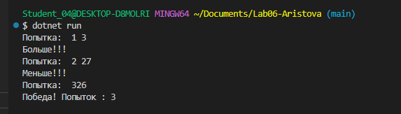
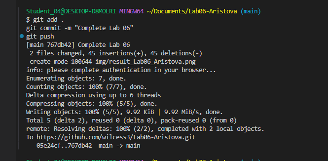

# Практическая работа №6

**ФИО:** Аристова Анастасия Александровна
**Группа:** ИСП-241
**Дата:** 2026-10-12

## Что изучено

- Цикл `while` проверяет условие **до** выполнения тела, а `do while` — **после**, поэтому `do while` гарантированно выполнится хотя бы один раз, даже если условие изначально ложно.
- Для накопления суммы или подсчёта количества переменную нужно объявлять **до** цикла, а изменять **внутри** него (иначе значение будет теряться на каждой итерации).
- Оператор `break` полностью прерывает цикл и передаёт управление следующему за ним коду, а `continue` пропускает только текущую итерацию и переходит к следующей.

## Скриншоты

1. 
2. 